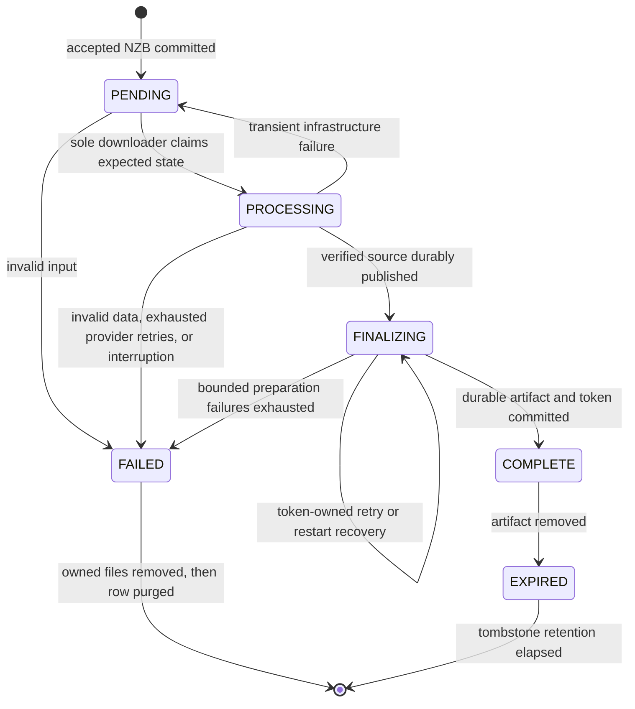

# Reliability and ownership contracts

nzbunny is one Linux process with a single FIFO downloader, at most two
finalizers, and independent provider and maintenance loops. SQLite owns job
state; managed directories own payload bytes. Keep this model when adding
features. Extra services, queues, and frameworks are unnecessary for this scope.

## Module boundaries

- `root.zig`: configuration, exclusive storage locks, initialization, and teardown.
- `http.zig`: listener, connections, request deadlines, and shutdown drain.
- `web.zig`: routes, upload admission, and artifact responses.
- `multipart.zig`, `pages.zig`, `rate_limit.zig`: parsing, pure HTML rendering,
  and admission rate limits. They do not schedule downloads.
- `worker.zig`: sole downloader ownership, provider evidence, and loop supervision.
- `download.zig`, `assembly.zig`, `repair.zig`: network work, verification,
  assembly, and the bounded PAR2 child process.
- `finalizer.zig`, `artifact.zig`: token-owned preparation and durable publication.
- `database.zig`: conditional state transitions, schema inspection, and migrations.
- `storage.zig`, `budget.zig`: shared disk and memory/decoded-byte reservations.
- `failure.zig`, `diagnostics.zig`: retry policy and operational visibility.

Configuration is owned by `Config` for the process lifetime. `Download` and
`Finalizer` are borrowed views with only the fields those components use. A
borrowed configuration view must never free strings. Generic function parameters
are reserved for actual generic behavior, such as the NNTP deadline wrapper.

## Job transitions

Pending jobs use `(created_at, rowid)` order, including equal-second submissions.
The downloader retains the NZB until `FINALIZING`, allowing transient filesystem
failures to requeue the same job. `fail` accepts an expected downloader state;
it cannot change a finalizing job. Finalizer transitions require the current
lease token. A stale token cannot renew, release, complete, or fail a newer owner.

Provider operations already retry within a download. Exhausting those retries,
malformed NZB/yEnc, missing unrecoverable articles, and declared size-limit
violations fail the job. Temporary admission shortages leave jobs pending and
preserve FIFO order. Infrastructure failures requeue after the poll interval;
ordinary bounded finalization failures back off 2, 4, 8, then 16 seconds.
Infrastructure finalization deferrals wait 2 seconds and refund the attempt.
The archive callback preserves output-limit errors separately from write failures
so oversized output cannot enter an infinite infrastructure retry.

## Memory, handles, reservations, and leases

Acquire a resource and immediately establish cleanup. A file must have a `defer`
close before its next fallible operation, including `sync`. Release reservations
on all exits. After memory is registered in a task manager, transfer its ownership
exactly once to the task or undo registration on admission failure.

Finalizer admission allocates task strings/map storage and reserves artifact
capacity before claiming a lease. The database allocates the returned lease token
before updating the row. Successful admission transfers the strings, token, and
reservation to the finalizer. State-write failure retains the task until the
write succeeds or shutdown intervenes. Cleanup never removes a live finalizer's
source. Tokens are freed using the database allocator that created them.

Only one process can hold the database/root locks. Therefore an in-memory active
finalizer cannot be replaced merely because its lease deadline passes. On restart,
all persisted leases belong to dead tasks and are reclaimed; their interrupted
attempts are refunded. Processing rows become failed, work and temporary output
are removed, and queued jobs remain queued. Completed artifacts remain available
when the provider is unavailable.

## Durable publication

1. Sync assembled payload files. After PAR2 rewrites a file, validate and sync it
   again; directory sync alone does not flush its contents.
2. Sync the output directory, rename staging output, and sync its managed parent.
   Sync the download root as well when establishing the managed parent.
3. Commit `FINALIZING` with the durable source path and discard the NZB content.
4. Sync artifact contents before publication (including the source inode in the
   hardlink path), rename the temporary artifact, then sync the artifact directory.
   Sync the root containing a newly created artifact directory.
5. Commit `COMPLETE` with the current lease and a unique download token.
6. Remove source work. Cleanup retries failures and removes deterministic artifact
   names even if publication preceded a failed database commit.

An existing artifact found during recovery is synced before reuse. Files and
SQLite cannot share one transaction; deterministic job ownership and idempotent
recovery bridge the gap. SQLite uses WAL with explicit `synchronous=FULL`.
Existing schema metadata is inspected read-only before any writable connection
can checkpoint WAL or run migrations. Unknown versions and malformed metadata
are rejected. Historical migration SQL stays immutable.

Storage accounting never follows symlinks or opens special files. Those entries
hold no regular payload bytes and consumers reject them before use. A broken
job containing a FIFO must reach validation and cleanup instead of blocking
storage accounting for every other job.

## Diagnostics

`/healthz` reports process liveness. `/readyz` reports whether new work can be
admitted, including current storage reservations and filesystem headroom. Its
body identifies `ready`, `shutting_down`, `database_unavailable`,
`download_state_write_failed`, `finalizer_state_write_failed`,
`provider_unavailable`, or `storage_capacity_unavailable`. Capacity is checked at
request time, so readiness recovers after cleanup without requiring another job.
Readiness is an observation, not a reservation for a future upload.

`/metrics` uses Prometheus text format. It exposes pending/processing/finalizing
job counts, oldest pending age, managed/reserved/available storage bytes,
readiness, and download/finalizer deferral, finalizer retry, cleanup failure,
and cleanup cycle counters. Counters are process-local and reset on restart.
Deferrals count admission/retry events, not distinct jobs. Logs include job IDs
and error names for correlation; metrics have fixed labels and never include job
IDs, filenames, provider credentials, or download tokens. Protect operational
routes with the same authenticated reverse proxy as the rest of the service.

## Validation

`make check` checks formatting and runs unit, integration, and operational suites
in Debug and ReleaseSafe. `make test-container` supplies the pinned Zig toolchain
and native dependencies. `make smoke` verifies the runtime image as its nonroot
user. CI runs both optimization modes, Compose validation, and runtime smoke.

The build passes a separate test-only C interposer to the operational suite. It
injects ENOSPC/EIO at directory-sync boundaries and SIGKILL after artifact rename.
It is never linked into the service or copied into the runtime image. Tests assert
NZB retention, bounded handle counts, refunded attempts, stale-owner isolation,
SQLite integrity, byte-for-byte output, repeated restart recovery, and eventual
cleanup. Allocation tests exercise task admission and database token allocation;
a failing I/O vtable proves repaired payload validation propagates sync failures.
These checks exercise crash recovery and sync ordering; they do not emulate a
physical power failure or certify the host filesystem or storage hardware.
